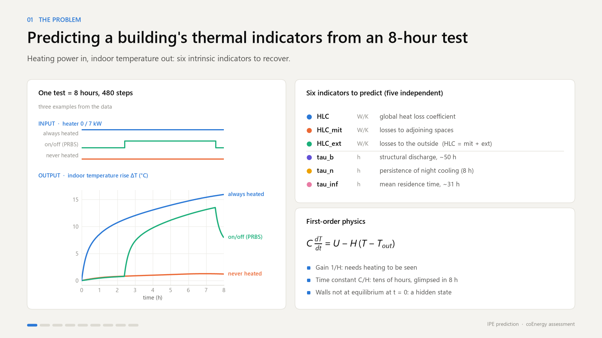
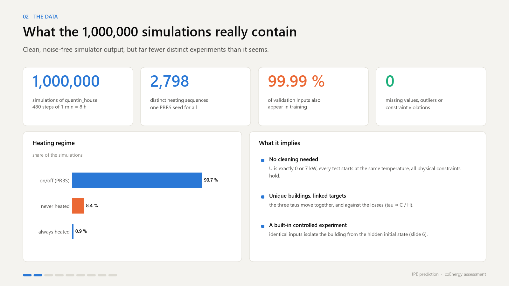
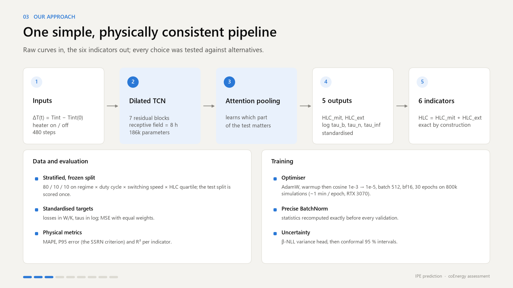
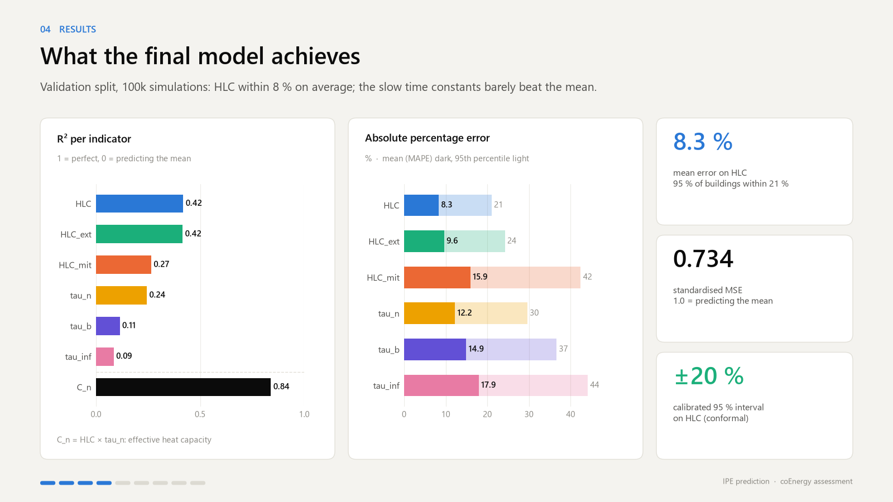
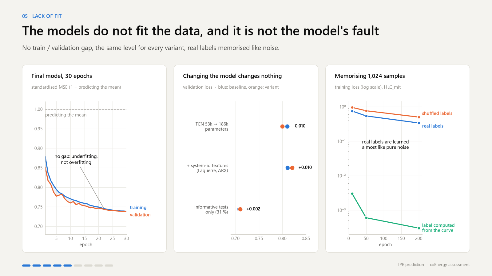
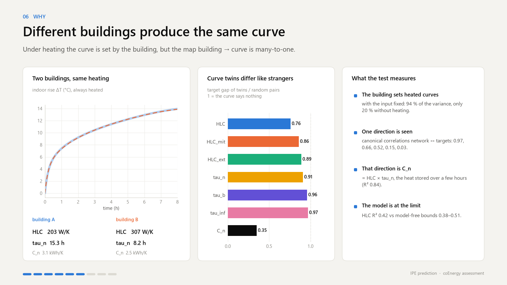
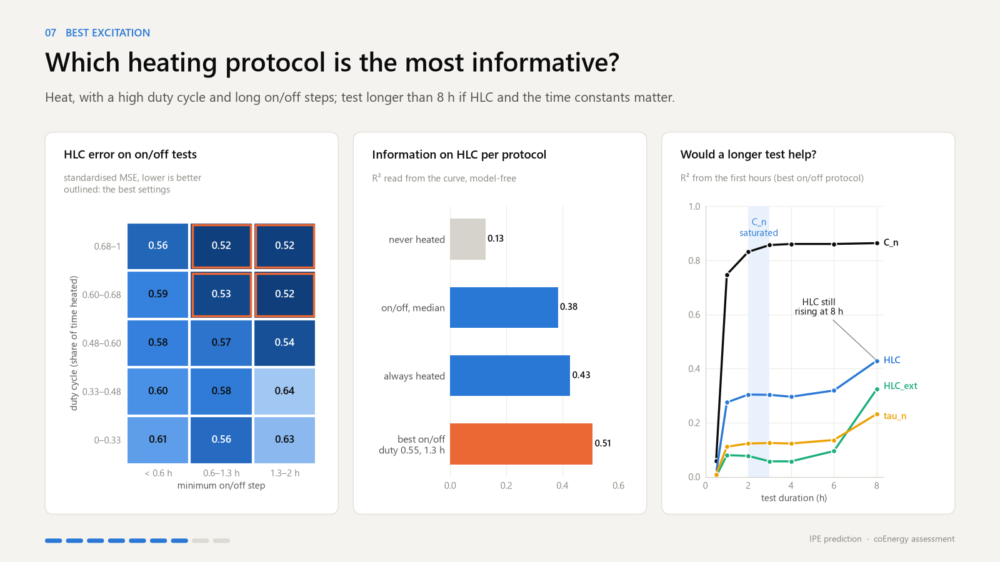
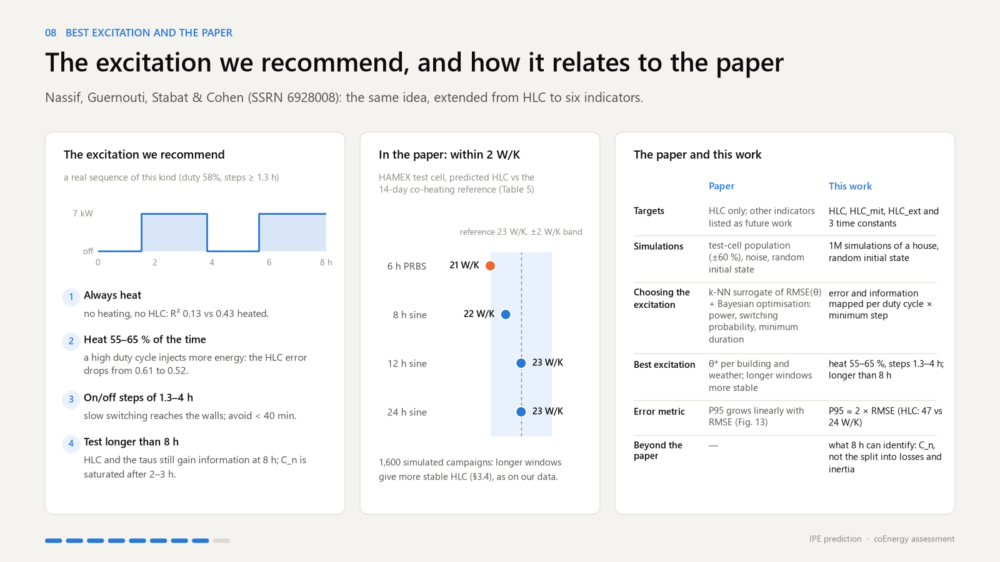
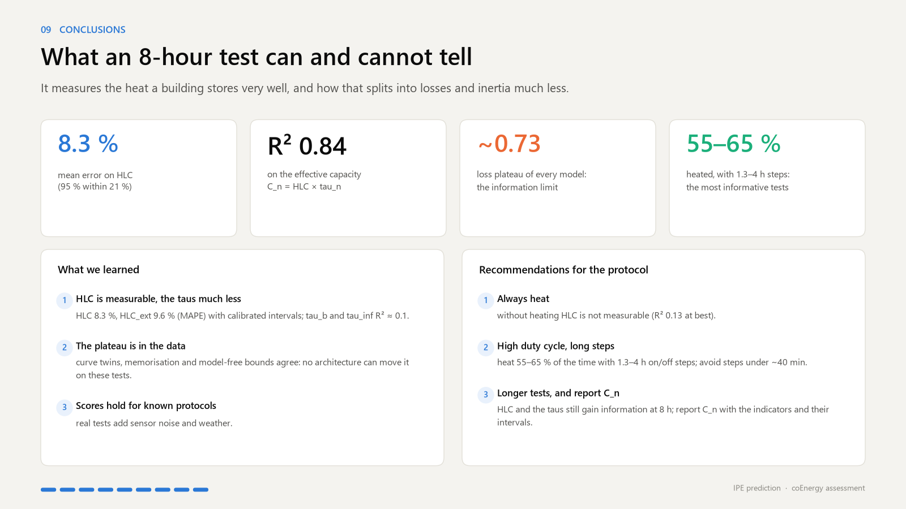

# IPE prediction — building thermal indicators from short transients

Predict six intrinsic thermal indicators of a building (`HLC`, `HLC_mit`, `HLC_ext`, `tau_b`,
`tau_n`, `tau_inf`) from 8 hours of indoor air temperature `Tint(t)` and heating power `U(t)`,
using 1,000,000 dynamic thermal simulations of `quentin_house` (coEnergy assessment).

**Start with [`notebooks/00_report.ipynb`](notebooks/00_report.ipynb)**: the executable report
(problem, data analysis, methodological choices, results, limits). The other notebooks hold the
detailed analyses it summarises.

## Main results (test split, 100k simulations, scored once)

Final model: dilated residual TCN with attention pooling (186k parameters), trained on the 800k
training simulations (`final_tcn_mse`). Standardised MSE 0.731 on test, 0.734 on validation
(1.0 = predicting the training mean): the choices made on validation did not overfit it.

| Indicator | MAPE | P95 APE | R² |
|---|---|---|---|
| HLC | 8.3 % | 20.9 % | 0.42 |
| HLC_ext | 9.7 % | 24.5 % | 0.42 |
| HLC_mit | 15.8 % | 41.8 % | 0.27 |
| tau_n | 12.2 % | 29.6 % | 0.25 |
| tau_b | 14.8 % | 36.3 % | 0.11 |
| tau_inf | 17.9 % | 44.0 % | 0.09 |

The plateau is an **identifiability limit of 8 h tests**, not a modelling one: under heating the
curve is almost entirely determined by the building, but different buildings give near-identical
curves. The test measures very well an effective heat capacity `C_n = HLC x tau_n`
(R² 0.84) and much less how it splits into heat losses and time constants (notebooks 04, 06).

## The project in 9 slides

Built by `scripts/make_readme_figures.py` (numbers from the notebooks, curves from the data).

**1. The problem.** An 8 h test gives the indoor temperature response to an on/off heater; the
six indicators describe how fast the building loses heat (`HLC`, split into adjoining spaces and
outside) and how slowly it responds (three time constants).



**2. The data.** One million clean simulations, but only 2,798 distinct heating sequences: the
same protocols repeat, which later serves as a controlled experiment.



**3. Our approach.** A dilated TCN with attention pooling on the raw curve; `HLC` is computed as
`HLC_mit + HLC_ext` so the physical constraint holds exactly; stratified frozen split.



**4. Results.** `HLC` within 8.3 % on average, `HLC_ext` 9.6 %; the slow time constants are barely
better than the population mean, while the effective capacity `C_n = HLC x tau_n` reaches R² 0.84.



**5. The models do not fit the data.** Training loss = validation loss, every architecture and
input variant stops at the same level, and on 1,024 samples the real labels are memorised barely
faster than shuffled ones, while a label computed from the curve is learned at once.



**6. Why: an identifiability limit.** With the same heating, two buildings with HLC 203 and
307 W/K give the same curve. Curve twins differ in their targets almost as much as random pairs,
except for `C_n`: the test measures the stored heat, not how it splits into losses and inertia.



**7. The best excitation.** Always heat; heat 55-65 % of the time with long on/off steps
(1.3-4 h), avoid fast switching; `C_n` is measured in 2-3 h but `HLC` and the time constants still
gain information at 8 h, so a longer test helps them.



**8. The best excitation, and the paper.** We recommend always heating, 55-65 % of the time, with
on/off steps of 1.3-4 h, and testing longer than 8 h when HLC and the time constants matter.
The paper behind the assessment (Nassif, Guernouti, Stabat & Cohen,
[SSRN 6928008](https://papers.ssrn.com/sol3/papers.cfm?abstract_id=6928008)) chooses the
excitation offline in the same spirit: a k-NN surrogate of the HLC error over the generator
settings (power, switching probability, minimum duration), minimised by Bayesian optimisation.
On the HAMEX test cell it recovers HLC within 2 W/K of a 14-day co-heating reference in 6 to
24 h (Table 5), and its 1,600 simulated campaigns show more stable HLC with longer windows, as
on our data. It predicts HLC only and lists other indicators as future work; we map error and
information per setting for six indicators and show what an 8 h test can identify (`C_n`) and
what it cannot.



**9. Conclusions and recommendations for the measurement protocol.**



## Setup

```bash
uv sync
```

Download the `quentin_house/` folder (20 `batch_*.pt` files, ~3.7 GB) into the project root.
It is git-ignored. Outputs (`outputs/`: frozen split, runs, figures) are git-ignored too; the
split is recreated identically from its seed if missing.

## Reproduce

```bash
uv run ipe-train --name final_tcn_mse                         # final model (defaults of config.py)
uv run ipe-train --name final_tcn_gaussian_nll --loss gaussian_nll   # same model + variance head
uv run ipe-evaluate --run outputs/runs/final_tcn_mse --split val
uv run ipe-evaluate --run outputs/runs/final_tcn_mse --split test    # once, at the very end
```

About 1 min per epoch on an RTX 3070 (bf16), 30 epochs. Then run the notebooks, and
`uv run python scripts/make_readme_figures.py` for the slides above.

| Notebook | Content |
|---|---|
| `00_report.ipynb` | **final report**: approach, choices and results |
| `01_eda.ipynb` | first EDA: data contract, targets, excitations, controllability |
| `02_architectures.ipynb` | train registered or notebook-defined models, compare runs |
| `03_target_structure.ipynb` | no repeated building, intrinsic dimension of the targets |
| `04_identifiability_uncertainty.ipynb` | final models: accuracy, error by protocol, calibrated intervals, canonical correlations |
| `05_informative_subset.ipynb` | training only on informative tests (no gain) |
| `06_advanced_eda.ipynb` | identical-input groups: building vs hidden state, information per protocol and duration, curve twins |
| `07_data_quality.ipynb` | integrity and quality checks (no cleaning needed) |

## Layout

```
src/ipe_prediction/
  util_assessement.py   loader provided with the assessment (kept verbatim)
  data.py               canonical target order, units, batch file listing
  training/             everything `ipe-train` / `ipe-evaluate` use
    config.py           DataConfig, TrainConfig, ExperimentConfig (defaults = final run)
    models/             one file per model, each with its own config dataclass
      __init__.py       registry: MODELS = {name: (Config, Model)}, build_model
      tcn_attn.py       dilated residual TCN + attention pooling (final model)
      cnn_gru.py        CNN + bidirectional GRU baseline
      model_a.py        residual conv blocks + average pooling -> bidirectional GRU
    splits.py           frozen, stratified, seeded 80/10/10 split over the 1M simulations
    dataset.py          compact in-memory tensors, input filter, Dataset and DataLoader
    preprocessing.py    model inputs and target scaling (fitted on the training split)
    losses.py           MSE or beta-NLL in the standardised target space
    metrics.py          per-target / per-family metrics, constraint checks
    engine.py           train / evaluate loops, lr schedule, mixed precision, load_model
    train.py            CLI + run(): training on train/val (never touches test)
    evaluate.py         CLI: evaluation of a run on one split; test allowed only once
  eda/                  analysis helpers used by the notebooks, never by training
    loading.py          raw-series loaders (load_dataset, load_targets_only)
    descriptors.py      descriptive statistics (excitation descriptors, PCA, downsampling)
    plotting.py         matplotlib style and figures
    identifiability.py  identical-input groups, ridge / kNN information measures, curve twins
    quality.py          raw-file scan, curve anomalies, group outliers, duplicates
scripts/
  kaggle_pack.py, kaggle_setup.py   train on a Kaggle GPU (see below)
  make_readme_figures.py            the summary slides of this README (docs/figures/)
notebooks/              see the table above
```

## Methodology in brief

* **Split**: 80/10/10 over the 1M simulations (seed 42), stratified on the excitation regime
  (never on / always on / PRBS x duty-cycle quintile x switching-speed tercile) and the HLC
  quartile; frozen in `outputs/splits/split_seed42.npz`. The test split is used once, at the end.
* **Inputs**: `ΔT(t) = Tint(t) - Tint(0)` (all simulations start from the same temperature), scaled
  by its training standard deviation, and the heater state (0/1, `U` is 0 or 7 kW), 480 steps.
* **Targets**: heat-loss coefficients standardised in W/K, time constants in log scale then
  standardised. The network predicts `HLC_mit`, `HLC_ext` and the three time constants; `HLC` is
  their sum, so the additivity constraint holds exactly.
* **Loss**: MSE in that standardised space, equal weights (or beta-NLL with a variance per target).
* **Training**: AdamW, linear warmup (1 epoch) then cosine decay 1e-3 -> 1e-5, batch 512, bf16
  autocast, gradient clipping at 1, best validation epoch kept.
* **Precise BatchNorm**: before each validation, the BatchNorm statistics are recomputed over 100
  training batches (weights frozen). The default moving-average statistics depend on the last
  batches seen (curves of very different amplitude) and made the validation loss jump from epoch
  to epoch; with exact statistics the score reflects the weights only.

Training options: `uv run ipe-train --help` (`--model`, `--epochs`, `--lr`, `--loss`, `--targets`,
`--max-train`, `--min-duty-cycle`, `--min-step-hours`, `--resume`, ...). To add a model, create
`models/<name>.py` with a config dataclass and an `nn.Module` built as
`Model(config, in_channels, n_outputs)`, and register it in `MODELS`.

## Branches

* `main`: the final pipeline on one GPU, the analysis notebooks and the report.
* `kaggle-ddp` (this branch): the same, plus multi-GPU training (DistributedDataParallel) for the
  Kaggle T4 x2 accelerator, learning-rate restarts and the overfitting run (below).

## Training on Kaggle (free GPU)

```bash
kaggle datasets init -p quentin_house && kaggle datasets create -p quentin_house   # data, once
python scripts/kaggle_pack.py --user <kaggle-username>
kaggle datasets create -p dist/kaggle/ipe-code      # then: kaggle datasets version -p ... -m "..."
```

In a Kaggle notebook with both datasets as inputs:

```python
import glob
%run {glob.glob("/kaggle/input/**/kaggle_setup.py", recursive=True)[0]}
!python -m ipe_prediction.training.train --name final_tcn_mse
```

### Both GPUs (T4 x2) and the overfitting run

`--ddp` starts one process per GPU (DistributedDataParallel). `--batch-size` stays the global
batch (256 per GPU with the default 512); every process scores the validation set, process 0 logs
and saves. A run can be resumed with or without `--ddp`.

Goal of this run: find how far the best model (`tcn_attn`) can **fit the 800k training
simulations**, generalisation being only measured, not sought. `final_tcn_mse` ends with a
training loss equal to its validation loss (0.739 vs 0.737): it underfits, so the run removes
every regulariser and trains for hundreds of epochs without ever annealing the learning rate:

```python
!python -m ipe_prediction.training.train --name overfit_tcn --ddp --epochs 300 \
    --lr-schedule cosine_restarts --lr 1e-3 --min-lr 1e-4 --restart-epochs 50 \
    --weight-decay 0 --val-subset 0 --train-eval-subset 100000 \
    --model-set dropout=0 mlp_hidden=256
# next Kaggle session (previous output as input): extend the same run
!python -m ipe_prediction.training.train --name overfit_tcn --ddp --resume --epochs 700
```

* `cosine_restarts` (SGDR): cosine cycles of 50 epochs from 1e-3 down to 1e-4, then back to 1e-3.
  The lr never goes below 10 % of its peak, and each restart kicks the weights out of a plateau;
  its shape does not depend on `--epochs`, so the run can be extended with `--resume --epochs N`
  (also true of `constant`). No early stopping, no reduce-on-plateau.
* `dropout=0`, `--weight-decay 0`: no regularisation; wider head (`mlp_hidden=256`). The width
  of the TCN (`channels=64`) can be raised with `--model-set channels=96`, at ~2x the time per epoch.
* `--val-subset 0`: the whole validation split (100k) each epoch; the test split (100k) stays
  untouched until `ipe-evaluate --split test`.
* `--train-eval-subset 100000`: 100k training simulations also scored each epoch in evaluation
  mode; the gap with the validation is the overfitting. Each epoch logs the loss, MAPE and **R2
  of every output** on the validation (and the training R2 on the next line); `history.csv`
  keeps them all, `summary.json` compares the last and the best epochs.
* A Kaggle session stops after 12 h: train in chunks (`--epochs` then `--resume --epochs`)
  sized from the seconds per epoch shown in the log.
